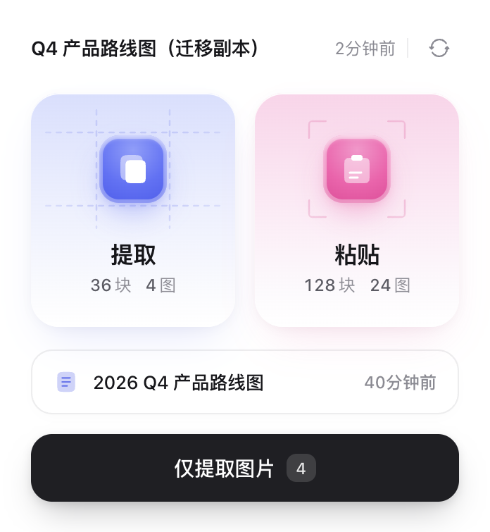
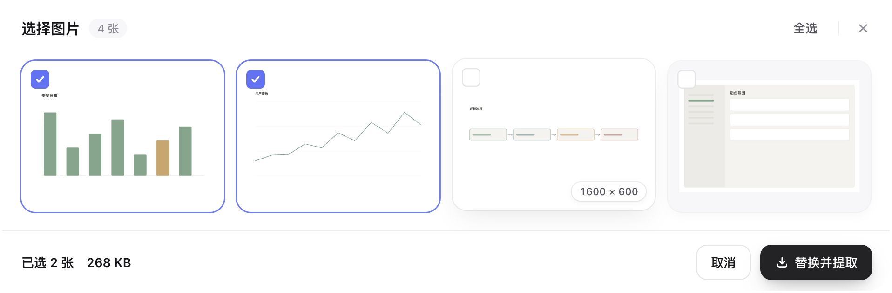

<p align="center">
  
</p>

<p align="center">
  <a href="https://developer.chrome.com/docs/extensions/develop/migrate/what-is-manifest-v3"></a>
  <a href="https://nodejs.org/"></a>
</p>

<p align="center">
  <a href="#产品截图">产品截图</a>&nbsp;&nbsp;·&nbsp;&nbsp;
  <a href="#核心能力">核心能力</a>&nbsp;&nbsp;·&nbsp;&nbsp;
  <a href="#安装与构建">安装与构建</a>&nbsp;&nbsp;·&nbsp;&nbsp;
  <a href="#native-host-配置">Native Host 配置</a>&nbsp;&nbsp;·&nbsp;&nbsp;
  <a href="#项目结构">项目结构</a>
</p>

## 产品截图

<table>
  <tr>
    <td align="center" width="38%">
      <br/>
      <sub>主界面：提取、缓存状态与粘贴</sub>
    </td>
    <td align="center" width="62%">
      <br/>
      <sub>图片选择面板：预览、勾选与批量提取</sub>
    </td>
  </tr>
</table>

## 核心能力

- **正文与结构迁移**：提取飞书 / Lark 文档正文，并在目标文档中恢复排版与占位关系。
- **批量图片选择**：从正文结构中识别图片，支持预览、勾选和批量提取。
- **跨账号画板重建**：统计文档画板数量；由 Native Host 调用 `lark-cli` 读取源画板元数据，再在目标浏览器端重建画板。
- **安全边界隔离**：通过扩展消息边界限制页面注入、缓存访问与 Native Messaging 调用；不读取或复制浏览器 Cookie、`Authorization` 等登录凭据。

## 使用流程

1. 在源飞书文档打开扩展，点击「提取文档」，等待正文、图片和画板信息进入缓存区。
2. 切换到目标飞书文档（同账号或不同企业/账号均可，需具备编辑权限）。
3. 打开扩展并点击「粘贴副本」，等待正文写入和画板导入完成。

## 安装与构建

环境要求：Node.js `^20.19.0` 或 `>=22.12.0`。

```bash
npm install
npm test
npm run build
```

构建产物位于 `dist/feishu-extension`。在 Chrome / Edge 扩展管理页开启「开发者模式」，选择「加载已解压的扩展程序」并加载该目录即可。

## Native Host 配置

跨账号画板迁移需要本机安装 Native Messaging Host，并通过 `lark-cli` 使用已授权身份读取飞书 OpenAPI 数据：

```bash
npm run install:native-host
lark-cli whoami
```

> 修改 `native-host/` 后需重新执行安装命令；首次安装或更新后请完全退出并重启 Chrome，再重新加载扩展并刷新文档页。

如果源文档与目标文档使用不同的 `lark-cli` profile，可按域名配置映射（需先通过 `lark-cli profile list` 与 `lark-cli auth status --verify --profile <name>` 校验）：

```bash
npm run install:native-host -- \
  --map bytedance.sg.larkoffice.com=corp \
  --map my.feishu.cn=personal
```

## 项目结构

<details>
<summary>查看目录与测试说明</summary>

```text
extension/                 Chrome 扩展入口、Popup、页面 Bridge 与 Service Worker
extension/popup/           当前版本的弹窗 UI
extension/shared/          Popup、Bridge、Service Worker 共用协议与工具
extension/content/         图片选择面板与页面内容适配
native-host/               Native Messaging Host、安装器与飞书 API 调用
src/feishu-runtime/        注入飞书页面 MAIN world 的运行时模块
lib/                       构建时内联的纯函数和迁移辅助模块
bin/                       扩展构建与本地重载脚本
tests/                     运行时、构建、安全边界和迁移测试
```

运行测试：

```bash
npm test
```

</details>
